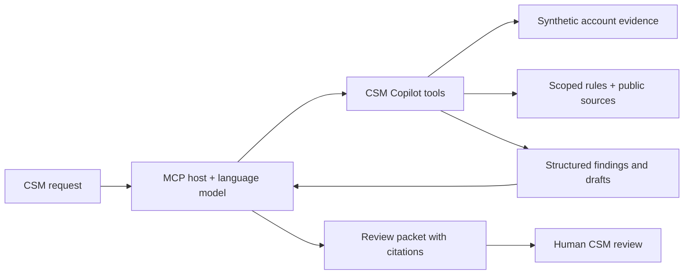

> Independent portfolio project. Not affiliated with, endorsed by, or connected to Unity. All customer records are synthetic.

# CSM Copilot

**Move customer onboarding forward without turning uncertainty into a promise.**

A working MCP server and interactive case explorer for a customer-success morning review: find accounts needing attention, inspect app/platform evidence, draft bilingual follow-ups, and prepare technical handoffs.

**[Explore the interactive demo](https://yuchi-wang02.github.io/csm-copilot/)** · **[Three-minute interview walkthrough](docs/INTERVIEW.md)** · **[Evaluation results](evidence/EVALUATION.md)** · **[Learning path](docs/LEARNING.md)**


[](https://github.com/Yuchi-Wang02/csm-copilot/actions/workflows/ci.yml)
[](https://github.com/Yuchi-Wang02/csm-copilot/actions/workflows/pages.yml)

## The business problem

A publisher wants to launch on Friday. Sales says integration is nearly complete. An iOS test passed, but a non-test Android device shows a blank Offerwall. The CSM needs to decide what to ask, what to document, and when to involve technical support.

A fluent message is easy to generate. A useful message must preserve the difference between **confirmed failure**, **missing evidence**, and **a possible explanation**. This project makes that distinction visible all the way from source records to the customer follow-up.

The v0.2 scope is deliberately bounded: Offerwall publisher onboarding, two issue families (no offers and reward callbacks), five fictional accounts, six app/platform integrations, English and Chinese follow-ups. It does not reproduce a production CRM or Unity's internal process.

**New in v0.2:** source ownership and structured-claim agreement are enforced before tools use the data. A valid iOS evidence ID cannot certify Android; another customer's contact cannot reset this account's clock; ticket details cannot overwrite the affected app/platform. Explore the [eight-case evidence-boundary replay](https://yuchi-wang02.github.io/csm-copilot/#integrity) or read [the reproduced failure and fix](docs/EVIDENCE.md). The full behavior suite now has 44 tests.

## Start with one case

1. Open **Lantern Games** in the [demo](https://yuchi-wang02.github.io/csm-copilot/).
2. Inspect Android: currency approval and Test Only are **unknown**; a device check is **not met**.
3. Switch to iOS. Its evidence is separate and its scoped checklist is complete.
4. Open **Follow-up** and switch between English and Chinese. The draft requests evidence without inventing a deadline.
5. Open **Handoff**. Known fields carry an evidence reference; missing SDK version, time window and logs stay missing.
6. Apply the synthetic update below the explorer. Two settings become confirmed, but the failed device check still requires a retest.

The site is a **deterministic replay of actual Python engine outputs**, not a live AI conversation. Its data is regenerated with `python scripts/build_demo.py`.

## Where AI fits



The model-enabled MCP host interprets the request, chooses tools, and can rewrite drafts. The server handles dates, scope, evidence references and checklist states deterministically. Default drafts are transparent templates; the project does not require an embedded paid model API.

**Verified:** real stdio MCP initialization, tool discovery, seven tool calls, prompt retrieval and invalid-ID errors. **Not measured:** live model orchestration quality or customer productivity. The checked-in transcript is a scripted MCP client run, not an LLM trace. This distinction keeps protocol verification separate from AI performance.

## Tools

| Tool | Purpose | Important boundary |
|---|---|---|
| `list_accounts` | Find stale contacts, order by upcoming launch | Strict `> 3 days`; live accounts excluded by default |
| `get_account_context` | Retrieve integrations, issues and evidence | Customer text is data, never instructions |
| `check_readiness` | Evaluate a scoped checklist per app/platform | `unknown` is not `not_met`; complete is not launch approval |
| `triage_issue` | Retrieve candidate checks and follow-up questions | Lexical baseline, not diagnosis or calibrated confidence |
| `draft_ticket` | Prepare an engineering handoff | Missing fields are explicit; no external submission |
| `draft_followup` | Produce English or Chinese follow-up templates | Drafting never changes contact history |
| `validate_draft` | Flag a few unsupported-promise patterns | Regex lint cannot establish factual support |

The `morning_review` MCP prompt composes the complete workflow. All tools are read-only and repeatable. There is no email, support-system or advertising-platform write integration.

## Run locally

Python **3.11–3.13**; verified locally on Windows / Python 3.13. GitHub Actions tests Windows and Ubuntu.

```sh
git clone https://github.com/Yuchi-Wang02/csm-copilot.git
cd csm-copilot
python -m venv .venv
```

Activate the environment:

```powershell
# Windows PowerShell
.venv\Scripts\Activate.ps1
```

```sh
# macOS / Linux
source .venv/bin/activate
```

Then install and verify:

```sh
python -m pip install -e ".[dev]"
python -m pytest -q
python scripts/mcp_smoke.py --output evidence/mcp-transcript.json
python scripts/build_demo.py
python -m http.server 8000 --directory demo
```

Open `http://localhost:8000`. The static demo also works by opening `demo/index.html`; clipboard support may vary on file URLs. The optional Google Fonts request falls back to local system fonts when offline. No account data leaves the page.

To print the full review packet without a browser:

```sh
csm-demo --output review-packet.json
```

### Connect an MCP host

After installation, configure a stdio server with the **absolute Python path inside the environment**:

```json
{
  "mcpServers": {
    "csm-copilot": {
      "command": "/absolute/path/to/csm-copilot/.venv/bin/python",
      "args": ["-m", "csm_copilot.server"]
    }
  }
}
```

Windows example: `"command": "C:\\projects\\csm-copilot\\.venv\\Scripts\\python.exe"`. No working directory is required because fixtures are packaged with the module. Host configuration formats vary; see [MCP setup and demo prompts](docs/MCP.md).

Try: **“At the bundled snapshot, review accounts more than three days past their last actual contact. Check each platform, draft follow-ups, and prepare handoffs for recorded issues. Preserve unknowns and cite evidence.”**

## What the evaluation actually shows

| Diagnostic | Result | Interpretation |
|---|---:|---|
| Development messages | 12/12 exact category-set matches | Six synthetic families; development feedback only |
| Family-separated diagnostic messages | 14/18 matches | Nine different families, but same-session authorship; not a blinded test |
| Five-account morning queue | 0 false positives / 0 false negatives | Checks the fixed fixture, not general business prioritization |
| Eight promise-lint probes | 4 TP / 2 FN / 1 FP / 1 TN | The lint misses confident unsupported statements and flags one negated promise |

**The failures stay in the report.** Indirect wording and negation expose the lexical baseline's limits. English/Chinese paraphrases remain in the same split. There are no claims of measured time savings, business impact, production readiness, or independent human validation.

See [per-case results](evidence/evaluation.json), [methodology](evidence/EVALUATION.md), the [verification record](docs/VERIFICATION.md), and the [real MCP transcript](evidence/mcp-transcript.json). Unit tests separately cover time boundaries, platform isolation, unknown states, missing provenance, draft side effects, invalid inputs and partial-confirmation retesting.

## Portfolio rationale

Created for **Yuchi Wang**, connecting business analytics and AI study with customer-facing operations, bilingual communication, and evidence-based process controls.

| Capability the project makes inspectable | Artifact |
|---|---|
| Translate an ambiguous customer situation into next actions | [Case walkthrough](docs/INTERVIEW.md) |
| Design controls around incomplete information | [Architecture and decisions](docs/ARCHITECTURE.md) |
| Communicate across customer and technical audiences | Bilingual drafts and structured handoffs in the demo |
| Evaluate an AI-adjacent workflow honestly | [Failure cases and raw results](evidence/EVALUATION.md) |
| Learn beyond a generated prototype | [Exercises and mastery checklist](docs/LEARNING.md) |

**Contribution transparency:** Yuchi selected the project direction, intended audience and realistic CSM workflow, and commissioned the build. Implementation, tests, documentation and synthetic cases were produced with substantial AI assistance. The repository does not claim unaided coding, completed personal mastery exercises, or human validation that has not happened. [Development notes](docs/DEVELOPMENT.md) record a real integration failure and fix.

## Repository map

```text
src/csm_copilot/   Evidence schema, workflow engine, MCP server, packaged fixtures
demo/             Static interactive explorer generated from engine outputs
tests/            Behavior and boundary tests
evaluation/       Labeled diagnostic messages and reproducible evaluator
evidence/         Generated results, workflow packet and MCP transcript
docs/             Architecture, sources, interview guide and learning path
scripts/          MCP client smoke test and demo-data builder
```

Public documentation is linked and paraphrased in [the source register](docs/SOURCES.md). Project operating policies are labeled separately from official product documentation. Source review date: **2026-10-14**. See [limitations and data handling](docs/LIMITATIONS.md) before extending the prototype. Code is MIT licensed; referenced vendor documentation remains under its own terms.
