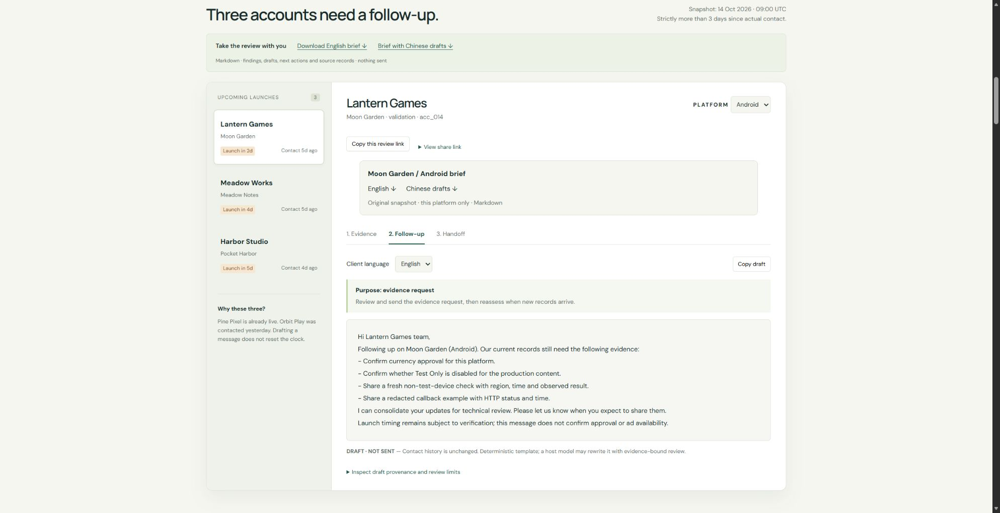

> Independent portfolio project. Not affiliated with, endorsed by, or connected to Unity. All customer records are synthetic.

# CSM Copilot

**Move customer onboarding forward without turning uncertainty into a promise.**

A customer-success portfolio by **Yuchi Wang**: a working Model Context Protocol (MCP) server and interactive case explorer that turn account evidence into bilingual follow-ups and technical handoffs.

**[Start the three-minute review](https://yuchi-wang02.github.io/csm-copilot/#start)** · **[Project brief (PDF)](demo/project-brief.pdf)** · **[Interview walkthrough](docs/INTERVIEW.md)** · **[Run locally](docs/LOCAL_SETUP.md)**

[](https://yuchi-wang02.github.io/csm-copilot/?case=lantern_android&view=followup&lang=en#workspace)

Screenshot from v0.27.1. The website replays Python workflow outputs and saved model attempts; it does not run a live AI chat or send messages.

[](https://github.com/Yuchi-Wang02/csm-copilot/actions/workflows/ci.yml)
[](https://github.com/Yuchi-Wang02/csm-copilot/actions/workflows/pages.yml)

## The business problem

A publisher wants to launch on Friday. An iOS test passed, but a non-test Android device shows a blank Offerwall. The CSM needs to decide what to ask the customer, what to document, and when to involve technical support.

The prototype follows that work across **five fictional accounts and six app/platform integrations**, covering Offerwall onboarding, blank-offerwall reports and reward callbacks. It preserves the difference between a recorded failure, missing evidence and a possible explanation.

## Start with one case

1. **[Inspect Android](https://yuchi-wang02.github.io/csm-copilot/?case=lantern_android&view=evidence&lang=en#workspace).** Currency approval and Test Only are unknown; the device check is recorded as not met. Expand the source view to read the dated evidence.
2. **[Read the next customer question](https://yuchi-wang02.github.io/csm-copilot/?case=lantern_android&view=followup&lang=en#workspace).** The draft asks for missing confirmations and a fresh device result. Switch to Chinese, then inspect the handoff's missing fields.
3. **[Compare iOS](https://yuchi-wang02.github.io/csm-copilot/?case=lantern_ios&view=followup&lang=en#workspace).** Its separate checklist is complete, so the next action is a launch-plan review. Completion is not launch approval.
4. **[Add fresh evidence](https://yuchi-wang02.github.io/csm-copilot/?case=lantern_android&view=evidence&lang=en&update=2#customer-update).** Passing new checks changes the Android follow-up to an issue-status question; it does not automatically close the earlier complaint.

Every draft remains unsent. Drafting does not update contact history. Review dates and source dates stay distinct: moving the review clock forward does not refresh customer records.

## Where AI fits

**CSM request → AI host → scoped tools → results returned to the AI host → human review**

An AI host can choose tools and rewrite drafts. The Python server handles dates, platform scope, checklist states and source references deterministically. Its default drafts are templates, so the workflow can run without a model or API key.

The repository preserves **ten local Qwen attempts across three prescribed tasks**. In one, four tool calls succeeded but the explanation described iOS as having “full compliance.” Later host-assisted corrections brought structured fields into agreement with tool results; free prose still required review. These are exploratory attempts with changing prompts and settings, not an independent benchmark.

[Inspect the original AI mistake](https://yuchi-wang02.github.io/csm-copilot/?run=qwen4-batch#model-runs) · [Follow the recorded corrections](https://yuchi-wang02.github.io/csm-copilot/?run=qwen4-constrained#model-runs) · [Read the raw-run review](evidence/MODEL_RUNS.md)

## Choose what to inspect

| Reviewer question | Evidence to open |
|---|---|
| Can the workflow prepare a useful technical handoff? | [Harbor callback case](https://yuchi-wang02.github.io/csm-copilot/?case=harbor_android&view=handoff&lang=en#workspace): request missing reproduction steps and redacted logs while retaining the supplied details |
| Can a CSM explain the next step to a publisher? | [Customer-education example](docs/CLIENT_EDUCATION.md) and [one-page teaching handout](demo/publisher-teaching-example.pdf) |
| Can recurring gaps become useful Product questions? | [Feedback review](https://yuchi-wang02.github.io/csm-copilot/#feedback): distinct account counts, source records and a proposed validation step |
| Can the system keep evidence in the right scope? | [Evidence probes](https://yuchi-wang02.github.io/csm-copilot/#integrity) and [the failure and fix](docs/EVIDENCE.md) |
| Can customer text authorize an action? | [Text/action probes](https://yuchi-wang02.github.io/csm-copilot/#trust-boundary), including remaining gaps |
| Can I explain the reasoning myself? | [Five practice decisions](https://yuchi-wang02.github.io/csm-copilot/#practice) and [learning exercises](docs/LEARNING.md) |

For presentation details, use the [interview walkthrough](docs/INTERVIEW.md). For a portable replay, download the fixed [v0.29.5 interview package](https://github.com/Yuchi-Wang02/csm-copilot/releases/tag/v0.29.5); the [package guide](docs/INTERVIEW_BUNDLE.md) distinguishes that release from newer source changes. [Sharing instructions](docs/SHARING.md) cover direct links, platform briefs and practice exports.

## Tools

All eight MCP tools are read-only. The two prompts compose a morning review and a Product-feedback discussion.

| Tool | Role in the workflow |
|---|---|
| `list_accounts` | Queue stale contacts and unknown-contact entries; prioritize planned launches |
| `get_account_context` | Read an account's integrations, issues and attributed evidence |
| `check_readiness` | Evaluate each app/platform separately; preserve unknown and unmet checks |
| `triage_issue` | Retrieve possible checks and questions using a lexical baseline |
| `draft_ticket` | Prepare a technical handoff with explicit missing fields |
| `draft_followup` | Produce an English or Chinese template for the current next action |
| `validate_draft` | Flag narrow promise patterns; this does not verify factual support |
| `friction_digest` | Turn snapshot gaps into proposed Product questions, without diagnosing defects |

[MCP setup and prompts](docs/MCP.md) · [Actual protocol transcript](evidence/mcp-transcript.json) · [Architecture and decisions](docs/ARCHITECTURE.md)

## What the evaluation actually shows

| Evidence | Observed result | Interpretation |
|---|---|---|
| Synthetic triage messages | 12/12 development; 16/18 reused cases, previously 14/18 | Rules were adapted after inspecting failures; the latter result is not a fresh holdout |
| Eight promise-lint probes | 4 true positives, 2 false negatives, 1 false positive, 1 true negative | Fluent unsupported claims can pass; one negated promise is flagged |
| Scripted MCP client | Eight tools and both prompts retrieved over real stdio | Protocol integration, separate from model tool choice |
| Windows and Linux CI | Workflow, browser-logic, export and installed-package checks | Reproducible authored cases; see the badges for current run status |

Known failures remain visible, including indirect wording, qualified negation and quoted topics. There is no independent human validation, measured customer impact or general model-reliability estimate.

[Methodology and results](evidence/EVALUATION.md) · [Verification scope](docs/VERIFICATION.md) · [Before/after triage explorer](https://yuchi-wang02.github.io/csm-copilot/#triage-review) · [Detailed development history](docs/DEVELOPMENT.md)

## Portfolio rationale

This project connects customer communication, business analytics and process controls. It makes a chain of decisions inspectable: identify the account, separate evidence from assumptions, ask a focused question, prepare a handoff, and review what an AI explanation adds.

**Contribution transparency:** Yuchi selected the direction, intended audience and CSM workflow, and commissioned the build. Implementation, tests, documentation and synthetic cases used substantial AI assistance. Unaided coding, completed personal mastery exercises and independent customer validation are not claimed.

The [learning path](docs/LEARNING.md) asks you to predict a result, change a copied input, inspect the output and explain the difference. [Practice](https://yuchi-wang02.github.io/csm-copilot/#practice) keeps initial reasoning separate from later reflection, with local save/resume and export. Those responses can provide a concrete basis for discussing your own learning.

## Run locally

To present the committed browser replay, follow the [local preview commands](docs/LOCAL_SETUP.md#view-the-browser-replay); no package installation or model is needed. To execute the workflow, use Python **3.11–3.13** and [install the Python package](docs/LOCAL_SETUP.md#install-the-python-workflow), then print a morning summary or export English/Chinese briefs. The [full verification sequence](docs/VERIFICATION.md#reproduction) includes JavaScript checks, package checks and PDF builders.

## Repository map

```text
src/csm_copilot/   Evidence schema, workflow engine, MCP server and fixtures
demo/             Interactive replay, downloadable briefs and PDFs
tests/, tests-js/  Authored behavior and boundary checks
evaluation/       Synthetic diagnostic cases and evaluators
evidence/         Workflow outputs, protocol transcript and model recordings
docs/             Sources, methods, setup, interview and learning guides
scripts/          Builders and protocol/package verification
```

Public sources are paraphrased and linked in the [source register](docs/SOURCES.md), reviewed **2026-10-14**. Project policies are labeled separately from official product guidance. See [limitations and data handling](docs/LIMITATIONS.md) before extending the prototype. Code is MIT licensed; referenced vendor documentation retains its own terms.
