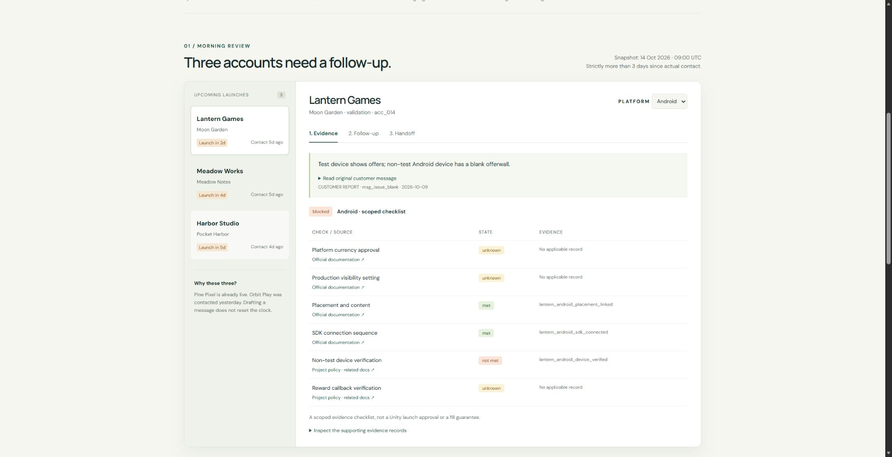
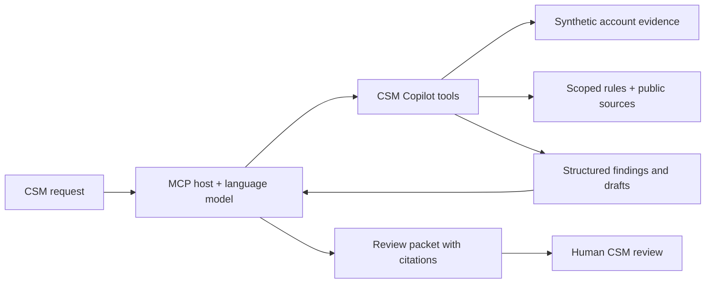

> Independent portfolio project. Not affiliated with, endorsed by, or connected to Unity. All customer records are synthetic.

# CSM Copilot

**Move customer onboarding forward without turning uncertainty into a promise.**

A working MCP server and interactive case explorer for a customer-success morning review: find accounts needing attention, inspect app/platform evidence, draft bilingual follow-ups, and prepare technical handoffs.

**[Start the three-minute review](https://yuchi-wang02.github.io/csm-copilot/#start)** · **[Two-page project brief (PDF)](demo/project-brief.pdf)** · **[Three-minute interview walkthrough](docs/INTERVIEW.md)** · **[Evaluation results](evidence/EVALUATION.md)** · **[Learning path](docs/LEARNING.md)** · **[Practice the decisions](https://yuchi-wang02.github.io/csm-copilot/#practice)**



[](https://github.com/Yuchi-Wang02/csm-copilot/actions/workflows/ci.yml)
[](https://github.com/Yuchi-Wang02/csm-copilot/actions/workflows/pages.yml)

## The business problem

A publisher wants to launch on Friday. Sales says integration is nearly complete. An iOS test passed, but a non-test Android device shows a blank Offerwall. The CSM needs to decide what to ask, what to document, and when to involve technical support.

A fluent message is easy to generate. A useful message must preserve the difference between **confirmed failure**, **missing evidence**, and **a possible explanation**. This project makes that distinction visible all the way from source records to the customer follow-up.

The current scope is deliberately bounded: Offerwall publisher onboarding, two issue families (no offers and reward callbacks), five fictional accounts, six app/platform integrations, English and Chinese follow-ups, a portfolio feedback review, and recorded local model attempts. It does not reproduce a production CRM or Unity's internal process.

## Choose what to inspect

For a first visit, use the [on-page review route](https://yuchi-wang02.github.io/csm-copilot/#start): inspect a customer next action, compare a recorded AI mistake with its corrections, then explain a decision before revealing the practice guidance. The suggested timing is a presentation aid, not a measured completion time.

For a focused handoff example, open [Harbor's callback case](https://yuchi-wang02.github.io/csm-copilot/?case=harbor_android&view=handoff&lang=en#workspace). Its next intake request asks for reproduction steps and redacted logs, while retaining the recorded SDK version, region and time window. The original report, broader candidate questions and unconfirmed HTTP 405 hypothesis remain inspectable in the panel and platform brief. Field presence does not verify its content; details mentioned only in free text still require CSM review.

| Portfolio question | Open this artifact |
|---|---|
| Can the workflow turn evidence into a useful next action? | [Android case](https://yuchi-wang02.github.io/csm-copilot/?case=lantern_android&view=evidence&lang=en#workspace), [Chinese iOS follow-up](https://yuchi-wang02.github.io/csm-copilot/?case=lantern_ios&view=followup&lang=zh#workspace), and [technical handoff](https://yuchi-wang02.github.io/csm-copilot/?case=harbor_android&view=handoff&lang=en#workspace) |
| What did the AI actually do, and where did it fail? | [Ten recorded local attempts](https://yuchi-wang02.github.io/csm-copilot/#model-runs) and [structured-response review](docs/RESPONSE_REVIEW.md) |
| Can a reviewer trace decisions to the right source? | [Eight evidence-boundary probes](https://yuchi-wang02.github.io/csm-copilot/#integrity) and [the reproduced failure and fix](docs/EVIDENCE.md) |
| How could a CSM frame recurring friction for Product? | [Source-linked feedback review](evidence/product-feedback.md) and [counting method](docs/PRODUCT_FEEDBACK.md) |
| Can customer text authorize an action? | [Six inspectable text/action probes](https://yuchi-wang02.github.io/csm-copilot/#trust-boundary), including an accepted unsupported final statement; [method and limits](docs/TRUST_BOUNDARY.md) |
| How can I explain the judgment myself? | [Five interactive practice decisions](https://yuchi-wang02.github.io/csm-copilot/#practice), downloadable notes, [local save/resume progress](docs/PRACTICE.md#resume-without-rewriting-the-learning-record), and [the learning path](docs/LEARNING.md) |
| Can I share a specific example or take it away? | [v0.25.0 interview download](https://github.com/Yuchi-Wang02/csm-copilot/releases/tag/v0.25.0), [package guide and rebuild instructions](docs/INTERVIEW_BUNDLE.md), [direct case, recording, triage and practice links](docs/SHARING.md), and [English morning brief](evidence/morning-review-en.md) |

A [two-page project brief](demo/project-brief.pdf) provides a portable introduction to the workflow, recorded AI failure and improvement, contribution boundaries, and evidence links. An [evidence timing view](docs/EVIDENCE_TIMING.md) shows source type, recorded date and age at the snapshot, including why a new settings confirmation does not replace an older failed test. A [three-stage customer update](https://yuchi-wang02.github.io/csm-copilot/?case=lantern_android&view=evidence&lang=en&update=2#customer-update) also shows why passing fresh checks leads to an issue-status question rather than an automatic closure. The website supports shareable case selections and individual model recordings, restoring both with browser Back/Forward. Practice evidence links open the relevant platform while retaining in-page notes. See [development notes](docs/DEVELOPMENT.md) for the iteration history and [verification](docs/VERIFICATION.md) for the checks and their limits.

In the AI trace section, expand **Compare the two callback handoff attempts** to inspect the same action batch before and after the identifier check. The comparison separates recorded tool behavior from AI-assisted explanation review, including the citation lost in the newer answer. A [portable comparison](evidence/MODEL_RUNS.md#compare-the-callback-handoff-attempts) links both raw traces.

Each recording also has **How this recorded AI run unfolded**: expand a turn to separate the model's proposal, actual MCP results, host rejection and correction feedback. The [four-turn correction example](https://yuchi-wang02.github.io/csm-copilot/?run=qwen4-constrained#model-runs) shows where expected values entered the conversation. Initial instructions and raw outputs remain available. This is a readable view of the existing recordings, not new inference or a change to their results.

## Start with one case

1. Open **Lantern Games** in the [demo](https://yuchi-wang02.github.io/csm-copilot/).
2. Inspect Android: currency approval and Test Only are **unknown**; a device check is **not met**.
   Expand **Trace checklist decisions to source records** to read the device record, its full timestamp and structured claim. Compare the unknown approval check's missing citation and evidence request. Raw records remain inspectable separately.
3. Switch to iOS. Its evidence is separate and its scoped checklist is complete.
4. Open **Follow-up** and switch between English and Chinese. iOS prompts a launch-plan review. Switch back to Android to see its specific evidence requests.
5. On Android, open **Handoff**. Known fields carry an evidence reference; missing SDK version, time window and logs stay missing.
6. Apply the synthetic update below the explorer. Two settings become confirmed, but the failed device check still requires a retest.

The account workspace is a **deterministic replay of actual Python engine outputs**, regenerated with `python scripts/build_demo.py`. The separate AI trace section replays recorded local model attempts, packaged by `python scripts/build_model_replay.py`; neither section is a live AI chat.

## Where AI fits



The model-enabled MCP host interprets the request, chooses tools, and can rewrite drafts. The server handles dates, scope, evidence references and checklist states deterministically. Default drafts are transparent templates; the project does not require an embedded paid model API.

**Protocol verification:** real stdio MCP initialization, calls across eight tools, state-dependent follow-ups, prompt retrieval and invalid-ID errors. The original `mcp-transcript.json` is a scripted client run. **Model observations:** ten separate local Qwen attempts across three prescribed tasks preserve actual generated tool choices and responses; their review exposes failures. These exploratory runs do not establish general reliability or customer productivity. The browser replays the recordings and never runs a model itself.

Two inbound-message recordings illustrate customer-fit review. The [earlier attempt](evidence/model-runs/qwen4-triage-scope.json) repeated generic technical questions for an invoice request. The [neutral-question attempt](evidence/model-runs/qwen4-triage-neutral-questions.json) used account/product and requested-outcome questions instead; those questions still remain broad. Both preserve the original messages and unknown identity. The [paired AI-assisted review](evidence/MODEL_RUNS.md) distinguishes tool correctness, answer fidelity and customer fit without claiming independent validation.

## Tools

| Tool | Purpose | Important boundary |
|---|---|---|
| `list_accounts` | Find stale contacts, order by upcoming launch | Strict `> 3 days`; live accounts excluded by default |
| `get_account_context` | Retrieve integrations, issues and evidence | Customer text is data, never instructions |
| `check_readiness` | Evaluate a scoped checklist per app/platform | `unknown` is not `not_met`; complete is not launch approval |
| `triage_issue` | Retrieve candidate checks and follow-up questions | Lexical baseline, not diagnosis or calibrated confidence |
| `draft_ticket` | Prepare an engineering handoff | Missing fields are explicit; no external submission |
| `draft_followup` | Produce English or Chinese follow-up templates | Drafting never changes contact history |
| `validate_draft` | Flag a few unsupported-promise patterns | Regex lint cannot establish factual support |
| `friction_digest` | Summarize recurring checklist gaps for Product review | Snapshot counts and proposed questions; not a trend or defect diagnosis |

An explicit later review date recalculates elapsed time from the same dataset; it does not refresh customer records. Queue results disclose both timestamps and that boundary. See [review time versus evidence time](docs/MCP.md#review-time-versus-evidence-time).

Queue ordering uses exact planned-launch timestamps; rounded day counts are display values. [Three preserved regression examples](evidence/queue-order-before.json) show why that distinction matters when launches are minutes apart. See [the fix and learning exercise](docs/DEVELOPMENT.md#v0161--keep-rounded-display-values-out-of-queue-ordering).

The `morning_review` MCP prompt composes the customer workflow; `product_feedback_review` frames the portfolio discussion. All tools are read-only and repeatable. There is no email, support-system or advertising-platform write integration.

## Run locally

Python **3.11–3.13**; verified locally on Windows / Python 3.13. GitHub Actions tests Windows and Ubuntu.

```sh
git clone https://github.com/Yuchi-Wang02/csm-copilot.git
cd csm-copilot
python -m venv .venv
```

Activate the environment:

```powershell
# Windows PowerShell
.venv\Scripts\Activate.ps1
```

```sh
# macOS / Linux
source .venv/bin/activate
```

Then install and verify:

```sh
python -m pip install -e ".[dev]"
csm-demo --format summary
python -m pytest -q
python scripts/mcp_smoke.py --output evidence/mcp-transcript.json
python scripts/build_demo.py
python -m http.server 8000 --directory demo
```

Open `http://localhost:8000`. Browser verification uses HTTP; direct-file opening of `demo/index.html` remains unverified in this environment. The optional Google Fonts request falls back to local system fonts when offline. No account data leaves the page.

To check the distributable package as well as the editable checkout:

```sh
python -m build
python scripts/verify_wheel.py
```

This creates a temporary clean environment, installs the built wheel and its dependencies, and runs both installed commands outside the repository. It checks the JSON workflow, English and Chinese exports, and real MCP results against the published artifacts. Dependency installation requires package-index access; no model or API key is needed. Both CI operating systems run this check. See [verification details](docs/VERIFICATION.md#installed-package-check).

For a first terminal walkthrough, run `csm-demo --format summary`. It prints the original queue, each platform's decision, unknown/failed check IDs, next actions and handoff missing fields in English. [Preview the generated summary](evidence/morning-summary.txt). No model or API key is required; the snapshot is fixed and nothing is sent. Use `--output morning-summary.txt` to save it. Summary format covers the full queue; platform selection and Chinese customer drafts use Markdown.

To print the full review packet without a browser:

```sh
csm-demo --output review-packet.json
csm-demo --format markdown --lang en --output morning-review.md
csm-demo --format markdown --lang zh --output morning-review-zh.md
```

For a focused leave-behind, use the **selected platform brief** links inside the case panel. Each contains only that platform's findings, follow-up, handoffs and source records, plus its account's contact evidence. Choose English or Chinese customer drafts independently of the displayed review step. The brief preserves the original snapshot; the separate synthetic-update comparison is excluded.

The same export is available from the CLI:

```sh
csm-demo --format markdown --integration harbor_android --lang en --output harbor-handoff.md
csm-demo --format markdown --integration lantern_ios --lang zh --output ios-review-zh.md
```

An unknown or unqueued integration produces an error before writing the output. `--integration` requires Markdown format; JSON continues to export the complete workflow. See [export scope and examples](docs/REVIEW_BRIEF.md#export-one-platform).

### Connect an MCP host

After installation, configure a stdio server with the **absolute Python path inside the environment**:

```json
{
  "mcpServers": {
    "csm-copilot": {
      "command": "/absolute/path/to/csm-copilot/.venv/bin/python",
      "args": ["-m", "csm_copilot.server"]
    }
  }
}
```

Windows example: `"command": "C:\\projects\\csm-copilot\\.venv\\Scripts\\python.exe"`. No working directory is required because fixtures are packaged with the module. Host configuration formats vary; see [MCP setup and demo prompts](docs/MCP.md).

Try: **“At the bundled snapshot, review accounts more than three days past their last actual contact. Check each platform, draft follow-ups, and prepare handoffs for recorded issues. Preserve unknowns and cite evidence.”**

## What the evaluation actually shows

| Diagnostic | Result | Interpretation |
|---|---:|---|
| Development messages | 12/12 exact category-set matches | Six synthetic families; development feedback only |
| Reused family-separated diagnostic messages | 16/18 current; 14/18 before adaptation | Inspected negation failures informed the new rule; not a fresh holdout or independent improvement estimate |
| Five-account morning queue | 0 false positives / 0 false negatives | Checks the fixed fixture, not general business prioritization |
| Eight promise-lint probes | 4 TP / 2 FN / 1 FP / 1 TN | The lint misses confident unsupported statements and flags one negated promise |

**The failures stay in the report.** Indirect wording still fails; qualified negation, quoted topics and unsupported callback-denial forms remain explicit development counterexamples. English/Chinese paraphrases remain in the same split. There are no claims of measured time savings, business impact, production readiness, or independent human validation.

The [callback-denial review](evidence/CALLBACK_DENIAL.md) preserves sixteen actual pre-change outputs. Its initial bounded rule repaired seven selected denial messages while retaining separate positive symptoms and three documented failures. Eleven message/handoff regression checks failed before that change and pass afterward. The later health-denial repair below handles one of those three failures. Neither iteration changes the original 16/18 diagnostic result or establishes general language understanding.

The later [present-tense callback-health repair](docs/CALLBACK_HEALTH.md) handles “callbacks are not failing” while retaining questions, qualifiers and separate symptoms for review. Five messages change in twelve newly inspected probes; seven checks failed before the repair and pass afterward. The practice case retains the historical failure, and the original diagnostic score is unchanged.

Use the [on-page triage explorer](https://yuchi-wang02.github.io/csm-copilot/#triage-review) to present one of these messages without opening JSON. It compares before/current categories with the project's authored expectation, shows the current route and notes, and keeps known failures selectable alongside repairs and positive controls.

A [separate phrase-boundary repair](evidence/TRIAGE_BOUNDARIES.md) stops examples such as `blanket invoice` from matching `blank`. Twelve development probes preserve actual pre-change outputs. Four substring collisions were repaired first; the later [explicit-denial repair](evidence/NEGATION_REVIEW.md) addresses the inspected negated-symptom case while indirect wording still fails. The original 30-message dataset is unchanged. Its earlier 14/18 result is preserved; the current 16/18 is a replay after adapting to inspected failures, not independent validation. An unrelated invoice request now stays with the CSM for scope clarification; this does not add a billing classifier or a Finance workflow.

See [per-case results](evidence/evaluation.json), [methodology](evidence/EVALUATION.md), the [verification record](docs/VERIFICATION.md), and the [real MCP transcript](evidence/mcp-transcript.json). Unit tests separately cover time boundaries, platform isolation, unknown states, missing provenance, draft side effects, invalid inputs and partial-confirmation retesting.

## Portfolio rationale

Created for **Yuchi Wang**, connecting business analytics and AI study with customer-facing operations, bilingual communication, and evidence-based process controls.

| Capability the project makes inspectable | Artifact |
|---|---|
| Translate an ambiguous customer situation into next actions | [Case walkthrough](docs/INTERVIEW.md) |
| Design controls around incomplete information | [Architecture and decisions](docs/ARCHITECTURE.md) |
| Communicate across customer and technical audiences | Bilingual drafts and structured handoffs in the demo |
| Evaluate model tool use and answer fidelity | [Actual model attempts](evidence/MODEL_RUNS.md) and [baseline diagnostics](evidence/EVALUATION.md) |
| Learn beyond a generated prototype | [Exercises and mastery checklist](docs/LEARNING.md) |

**Contribution transparency:** Yuchi selected the project direction, intended audience and realistic CSM workflow, and commissioned the build. Implementation, tests, documentation and synthetic cases were produced with substantial AI assistance. The repository does not claim unaided coding, completed personal mastery exercises, or human validation that has not happened. [Development notes](docs/DEVELOPMENT.md) record a real integration failure and fix.

## Repository map

```text
src/csm_copilot/   Evidence schema, workflow engine, MCP server, packaged fixtures
demo/             Static interactive explorer generated from engine outputs
tests/            Behavior and boundary tests
evaluation/       Labeled diagnostic messages and reproducible evaluator
evidence/         Generated results, workflow packet and MCP transcript
docs/             Architecture, sources, interview guide and learning path
scripts/          MCP client smoke test and demo-data builder
```

Public documentation is linked and paraphrased in [the source register](docs/SOURCES.md). Project operating policies are labeled separately from official product documentation. Source review date: **2026-10-14**. See [limitations and data handling](docs/LIMITATIONS.md) before extending the prototype. Code is MIT licensed; referenced vendor documentation remains under its own terms.
