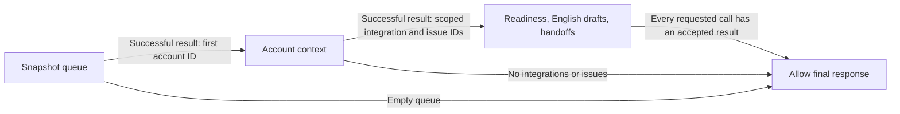

# From a failed plan to an enforced workflow

Two recorded Qwen3-4B morning-review attempts proposed a queue lookup and dependent calls together, using identifiers before any results existed. Adding a dependency paragraph did not change the stopping outcome: both five-action proposals exceeded the four-action limit, and no tool executed. Those recordings remain unchanged.

The next engineering change is an **opt-in host policy**, implemented in [dependency_policy.py](../src/csm_copilot/dependency_policy.py) and used by [run_local_host.py](../scripts/run_local_host.py). It validates each entire proposed batch against the current workflow state before dispatching any calls. It does not silently split a bad batch, invent identifiers, substitute a planned action, or infer completion from a final answer.

**Verification status:** automated policy tests and scripted-worker integration tests through the real MCP server pass. A [subsequent model attempt](LOCAL_MODEL.md#policy-enabled-attempt-parser-stops-the-proposal-first) enables the policy and receives its pending-action state, but still proposes five actions. The parser rejects that batch before dependency validation or tool execution. The recording does not demonstrate a policy rejection or completed work. Software enforcement and model task completion remain separate claims. This implementation postdates the fixed v0.29.8 interview bundle.

## What advances the workflow



| State | Accepted proposals | Condition for advancing |
|---|---|---|
| Awaiting queue | `list_accounts` alone; three-day threshold, non-live accounts, fixed snapshot | A successful structured queue result; select its first account without embedding fixture IDs in the policy |
| Awaiting context | `get_account_context` for that returned account alone | Matching account identity; unique integration and issue IDs scoped to that account |
| Reviewing | Pending readiness and English follow-up calls for returned integrations; pending handoffs for returned issues; at most four independent calls per batch | Each accepted successful result removes only its corresponding requested action |
| Complete | A final response | No requested action remains; an empty queue or a context with no work is explicit |

The policy supplies its pending actions to the model each turn. This is host planning assistance: a future successful run cannot be described as an unaided model discovering the entire plan. The model still proposes actions and writes the final explanation. The server's tool schemas stay unchanged. Calls are executed sequentially, even within an accepted independent batch.

Queue and context calls cannot be combined with their dependents. A valid prefix followed by an invalid action rejects the whole proposal before execution. Completed actions and duplicates in one batch are rejected; unsuccessful calls remain pending and may be retried. A malformed or mis-scoped successful result stops the run before later actions in that accepted batch. Earlier read-only calls are retained in the trace; there is no rollback claim.

## What the tests establish

[Policy tests](../tests/test_dependency_policy.py) use unfamiliar account, integration and issue IDs, so passing does not depend on knowing Lantern's fixture identifiers. They cover proposal-only state, failed tools, wrong scope, wrong language, malformed results, duplicate actions, explicit empty-work paths and snapshot isolation.

[Host integration tests](../tests/test_host_dependency_integration.py) substitute a scripted worker for the model while starting the actual MCP server over stdio:

- The scripted valid path performs seven calls in batches of 1, 1, 4 and 1, then produces a final response.
- A queue-plus-context proposal executes zero calls. A premature final response also executes zero calls and is rejected.
- A fabricated account after the queue, or a valid readiness call followed by a foreign issue, is rejected before any call in that batch.
- Injecting one tool error leaves that action pending; a later retry completes it without repeating already completed work.
- Injecting a readiness result with the wrong integration ID stops the batch and preserves the remaining work.

The fault cases alter returned data inside the test after real transport execution. They are deliberate software fault injection, not observed server faults. Temporary test traces are not added to the model recordings. The tests use no model weights or paid API.

```bash
python -m pytest -q tests/test_dependency_policy.py tests/test_host_dependency_integration.py
```

## Reproducing the policy-enabled attempt

Use the [local-model setup and command](LOCAL_MODEL.md#reproduce-a-local-attempt), select `--task morning_review --protocol batch`, add `--enforce-dependencies`, and choose a new output path. The flag is rejected for other tasks and protocols. It is independent of the earlier `--sequence-dependencies` prompt flag; record both values when comparing runs.

The trace retains the policy state and the exact state message supplied before each generation, plus each accepted result's resulting state. `policy_rejected` means a proposed batch or premature final failed policy checks. `policy_result_rejected` means a dispatched call returned data that failed the policy's result checks. Parser errors still occur before policy validation and retain their existing status. Correction requests remain explicitly budgeted and recorded; enabling this policy does not silently retry a rejected proposal.

## Limits to explain in an interview

This is a policy for the project's optional local host and one prescribed morning-review task. Other MCP clients do not inherit it. It is neither CRM authorization nor a general planner. It trusts the scoped, validated synthetic server records; it does not independently verify source truth, refresh records or assess which customer deserves commercial priority.

Result checks establish the minimum structure and available identity needed to track this workflow. Readiness results expose an integration ID, and handoffs expose an issue-derived draft ID. Follow-up results have no integration-ID field; the host correlates them with the request and checks draft state, language and a nonempty body. It does not independently prove that every sentence describes that integration correctly.

Allowing a final response means the requested tool work has completed, **not that the explanation is accurate**. It does not check the word limit, factual support, citation coverage, tone, approval promises or customer usefulness. The existing fixed-fixture call-coverage count is also separate from this dynamic policy state. Preserve both in future reviews.

The learning point to discuss is concrete: inspect a failed proposal, identify the dependency it violated, turn that dependency into a testable host rule, then run a new model attempt without rewriting the earlier failure. The new attempt still fails before its first tool call, even with the pending-action input. A next experiment could constrain generation to valid pending actions; that would add decoding assistance and require its own implementation, tests and recording. The unresolved goal is successful tool use followed by a useful, evidence-grounded explanation, not merely a rejected unsafe proposal.
