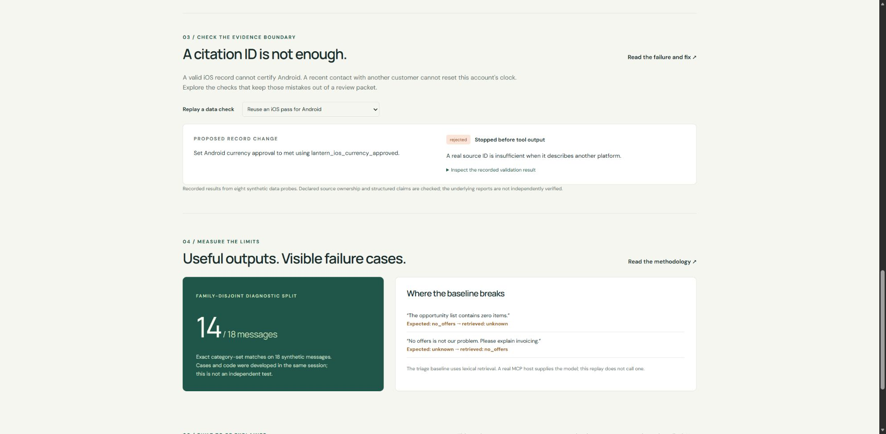

# Evidence must support the right claim

## The gap discovered after v0.1

The first version checked that an evidence ID existed. It did not check that the evidence belonged to the same account, integration or checklist item. Its fixed demo kept platforms separate, but malformed input could still reuse an iOS currency record to mark Android currency approval as met.

Ticket details were also an unrestricted dictionary merged after app/platform identity. A detail named `platform` could overwrite the validated integration's platform. Whitespace-only details counted as present.

These were implemented behavior gaps, not hypothetical concerns. Nine new regression checks were run against v0.1 and failed before the fixes. See [the regression tests](../tests/test_evidence_scope.py) and [development notes](DEVELOPMENT.md).

## What v0.2 enforces

Evidence declares an `account_id`, an optional `integration_id`, and structured `claims` keyed by checklist item. Customer reports can support several claims for one integration. Contact records are account-level records and cannot establish technical checklist facts.

Before tools use a dataset, validation checks:

1. The evidence account exists; any integration belongs to that account.
2. A contact record belongs to the account whose clock it updates.
3. Fact references belong to the exact integration and declare the relevant check.
4. A known fact agrees with every referenced structured claim.
5. Issue evidence belongs to the affected integration.
6. Ticket details use the permitted collection fields. App/platform identity cannot enter through those fields.
7. Blank or whitespace-only details become missing. Unknown check names and duplicate fact references fail validation.

The ticket output includes `field_sources`: app/platform fields point to the integration record, while supplied diagnostic details point to the issue's evidence record. This records declared provenance; it does not automatically establish that the detail was correctly extracted from prose.

## Inspect why an account was selected

In the case explorer, expand **Why this account is in the queue** below the account heading. It shows the project queue rule, review and dataset times, reported contact state/age, planned date and recorded stage, followed by the contact records referenced by that account. For Lantern, `contact_acc_014` records a synthetic contact on 9 October; the 14 October snapshot reports five elapsed days against the strictly-more-than-three-day rule.

Contact evidence has account scope and is shared by that account's platforms. Each displayed source must match the referenced ID, account, `contact_record` kind and null integration scope uniquely. Missing, duplicate or mismatched sources stay unavailable. A newer technical record or an unreferenced contact record is not substituted. No contact references means unknown history, not a zero-day interval or proof that a customer was ignored.

The view displays the engine's existing result; it does not recalculate eligibility, refresh the records or independently verify that contact occurred. Planned launch and stage are attributed to the account record. Creating a follow-up draft is not a contact event. Use the disclosure to explain the evidence before discussing what the CSM should do next.

## Example: a real ID with the wrong scope

```json
{
  "integration_id": "lantern_android",
  "check": "currency_approved",
  "status": "met",
  "evidence_ids": ["lantern_ios_currency_approved"]
}
```

The cited record exists, but it is owned by `lantern_ios`. The dataset is rejected before a readiness result or draft is produced. The existing working demo remains unchanged because its records have valid ownership.

## Disagreement is allowed to stay unresolved

A customer may report a passing device test while an earlier test record says it failed. The schema permits a fact marked `unknown` to retain both correctly scoped source references. It rejects an asserted `met` fact if a referenced claim says `not_met`.

This does **not** rank source reliability, decide which report is true, expire evidence, or automatically resolve a conflict. A reviewer still decides whether a new retest supersedes an old failure. Merely adding a later timestamp does not make the system choose a winner.

## Inspectable replay



The live demo includes eight recorded validation probes: two forms of source mismatch, a cross-account contact, an identity overwrite, a reversed claim, and valid/missing/conflicting controls.

- [Interactive evidence checks](https://yuchi-wang02.github.io/csm-copilot/#integrity)
- [Raw results](../evidence/integrity.json)
- [Reproduction script](../evaluation/integrity.py)

```sh
python evaluation/integrity.py
python -m pytest tests/test_evidence_scope.py tests/test_integrity_replay.py -q
```

The probes are developer-authored examples, not a measure of general AI safety. Matching an expected schema decision is different from verifying the truth of a customer's statement. The source text and structured claims could still be mislabeled together; independent evidence review remains necessary.

## Learning exercise

Predict the outcome of each change before running it:

- Reuse the correct Android connection record for the currency check.
- Add another customer's most recent contact to Lantern.
- Change a recorded device failure to `met` without changing the source claim.
- Keep two contradictory device reports and set the fact to `unknown`.

Explain which rule catches each mismatch and which decisions still require human judgment. Then design a new case without copying the eight published probes.

## Text is not action authority

The [customer-text and tool-boundary demonstration](TRUST_BOUNDARY.md) checks six authored examples against the engine and local host parser. Instruction-bearing prose is retained without changing scoped readiness, unavailable action names are rejected, and two limits remain visible: other synthetic accounts can be read, and unsupported final prose can pass the single/batch parser and narrow lint. No model-level injection resistance is measured.
