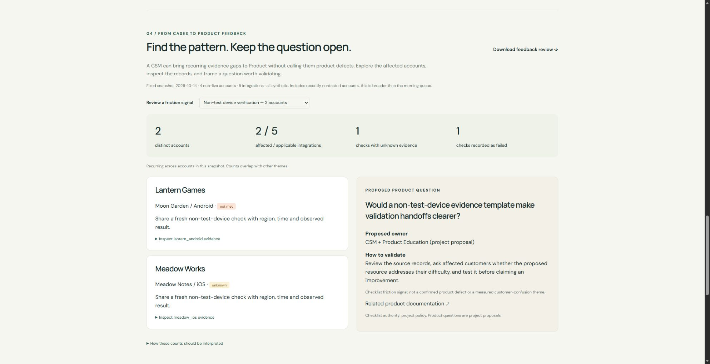

# From individual cases to a Product discussion

CSMs see patterns across accounts. A useful Product handoff preserves what customers actually reported and separates that evidence from a proposed improvement. This prototype adds `friction_digest`, a read-only MCP tool, plus an interactive [Product feedback review](https://yuchi-wang02.github.io/csm-copilot/#feedback) and a [downloadable review](../evidence/product-feedback.md).

## What the digest does

The digest evaluates the same scoped checklist used by the morning review for every non-live account. Recently contacted accounts remain included: the purpose is portfolio feedback, not selecting today's follow-up queue. `include_live=True` explicitly expands the cohort. The default snapshot contains four accounts and five integrations.

Each theme is one checklist requirement. The digest preserves `unknown` and `not_met` separately, reports affected integrations and distinct accounts, and carries the underlying source IDs, source text and timestamps. Unknown states without supporting records remain without records; the export never invents a customer quote to explain them.

For example, non-test-device verification affects two synthetic accounts. Lantern Games has one recorded failed check; Meadow Works has no applicable verification record. Both suggest an evidence-collection question, but only one is a recorded failure. A proposed validation template could be discussed with Product Education; this is not evidence that unclear documentation caused either case.

## Counting rules

| Question | Rule |
|---|---|
| What counts as an observation? | One evaluated check per integration, regardless of how many source records support it |
| What counts as an affected account? | A distinct account with at least one unknown or not-met integration for that theme |
| What counts as recurring? | At least two distinct accounts in the snapshot; an explicit project convention |
| What is the denominator? | Applicable integrations in the selected cohort, including those that passed |
| What happens to managed-currency callbacks? | They are not applicable under the existing rule, so they count as neither gaps nor denominator entries |
| Can theme counts be added? | No. The same account can appear in several themes |
| Does an old record prove a current problem? | No. The digest reports the fixed dataset snapshot and retains source dates; no freshness policy or resolution lifecycle is implemented |

Two platforms for one customer are two integrations and one account. Two source records for a failed check are still one observation. The tests exercise both cases, along with applicability, empty cohorts, input reordering, source scope and read-only repetition.

## What the AI host can contribute

Use the `product_feedback_review` MCP prompt to ask a model-enabled host to interpret the digest, inspect supporting records and draft a discussion packet. The tool supplies deterministic counts and proposed questions. The model may synthesize their wording; it must preserve the uncertainty and evidence boundaries.

This release does not measure that model behavior. The checked-in transcript verifies the real tool transport and prompt retrieval using a scripted client. It is not a model trace or evidence of semantic clustering quality.

## What this does not claim

These are checklist friction signals, not automatically discovered customer-confusion themes or confirmed defects. The Product questions and owner labels are unvalidated project proposals. There is no weekly trend, prevalence estimate, causal analysis, urgency score, prioritization decision or submitted Product ticket. The existing fixtures were not enlarged to manufacture recurrence.

A stronger next study would collect independently reviewed customer messages, define a theme-labeling rubric, evaluate whether the proposed explanations fit the messages, and compare feedback quality before and after a resource change. Those activities are future work.

## Interview exercise

1. Select **Non-test device verification** in the browser. Explain why two accounts can share an evidence-collection need without sharing a confirmed cause.
2. Open each source panel. Identify the failed test record and the account with no record.
3. Switch to **Reward callback verification**. Explain why its denominator is three integrations rather than five.
4. Switch to **Platform currency approval**. Explain why one account does not establish recurrence across customers.
5. Read the proposed Product question and say what additional evidence would persuade you to recommend the change.

The exercise tests business judgment and the ability to question a plausible AI-assisted summary. Personal completion is not claimed.
